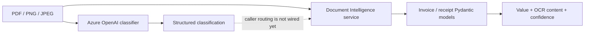

# AI Invoice Review

An early-stage document-processing project for extracting and structuring
invoice and receipt data. This README describes the implementation on
[`recover-local-work`](https://github.com/muskann9031-debug/e2e-invoice-review/tree/recover-local-work);
it does not claim that the full review application is complete.

> **Project status:** backend provider, classification, and schema components
> are implemented. A user-facing upload/review application and end-to-end
> orchestration are not present on this branch.

## The problem

Finance teams receive invoices and receipts as PDFs and images, often with
different layouts and languages. Before financial data can be reviewed, useful
fields such as supplier, dates, totals, tax, and line items must be extracted
while retaining evidence about where each value came from.

This project explores a small, typed foundation for classifying documents and
mapping Azure Document Intelligence output into reviewable Pydantic models.

## Implemented on this branch

- Calls Azure Document Intelligence's `prebuilt-invoice` and
  `prebuilt-receipt` models for PDF, PNG, and JPEG files.
- Maps invoice and receipt fields, totals, tax details, and line items into
  separate Pydantic models.
- Keeps parsed values alongside the original OCR `content` and Azure
  `confidence`; evidence can remain available when a typed value is missing.
- Reports malformed collection entries and skips them without logging invoice
  text.
- Uses Azure OpenAI's Responses API through a provider adapter configured from
  environment variables.
- Classifies PDF/image bytes as `invoice`, `receipt`, or `other` using
  Pydantic AI structured output. The result includes a schema-constrained
  confidence score.
- Includes a fictional 13-document multilingual sample corpus: 12 invoices and
  one receipt.

The classifier and the Document Intelligence methods are separate components:
the recovery branch does **not** yet automatically route a classification into
the matching extraction model.

## Technology

- Python 3.12+
- FastAPI, Pydantic v2, and Pydantic Settings
- Azure AI Document Intelligence
- Azure OpenAI Responses API and Pydantic AI
- `uv` with exact dependency pins and a committed lockfile
- Fictional PDF/image examples in English, Dutch, German, and French

## Architecture



- `backend/app/providers/` contains Azure/OpenAI client interactions.
- `backend/app/services/document_intelligent_services.py` exposes the two
  Document Intelligence analysis methods.
- `backend/app/pipeline/classification.py` accepts document bytes and a media
  type and returns the classification model.
- `backend/app/schemas/` contains shared extracted-value types and separate
  invoice/receipt models with `from_document_intelligence()` mappings.
- `playground/` contains manual inspection and mapping scripts.

## Run locally

### Prerequisites

- Python 3.12 or newer
- [`uv`](https://docs.astral.sh/uv/)

The frontend directory on this branch contains starter configuration only; no
frontend application is included in this implementation snapshot.

### Install

From the repository root:

```bash
cd backend
uv sync --locked
```

Create a local environment file from the placeholder template:

```powershell
Copy-Item .env.example .env
```

Or, in a POSIX shell:

```bash
cp .env.example .env
```

The project can be imported and its structured output model checked locally
without credentials or Azure requests:

```bash
uv run --locked --no-sync ruff check app
uv run --locked --no-sync python -c "from app.schemas.classification import DocumentClassification; print(DocumentClassification(document_type='invoice', confidence=0.95).model_dump())"
```

### Environment configuration

`backend/.env.example` contains placeholders, not working credentials:

| Variable | Purpose |
| --- | --- |
| `AZURE_DOCUMENT_INTELLIGENCE_ENDPOINT` | Azure Document Intelligence resource endpoint |
| `AZURE_DOCUMENT_INTELLIGENCE_KEY` | Local API-key credential for Document Intelligence |
| `AZURE_OPENAI_ENDPOINT` | Azure OpenAI OpenAI-compatible API endpoint |
| `AZURE_OPENAI_API_KEY` | Local API-key credential for Azure OpenAI |

The Azure OpenAI deployment identifier is currently fixed as `gpt-6-astra` in
the provider code; deploy that model under the expected name or update the
configuration design before use. Keep real credentials in the ignored local
`.env` file or a secret manager—never commit them.

**Azure requests may incur charges.** The smoke and playground scripts that
invoke Azure are intentionally not part of the local, no-network checks above.
No live Azure request is needed to install the project or validate the
Pydantic classification schema.

## Demo and screenshots

Screenshots and a demo recording are not available yet. Add them after the
upload-to-review flow is integrated and manually verified:

<!-- Portfolio TODO: add a redacted upload/review screenshot and a short demo GIF. -->

## Current limitations

- No FastAPI application entry point, upload endpoint, or end-to-end pipeline
  is included on this branch.
- The classification result does not yet select and invoke an extraction model.
- No independent LLM field extraction, merge/provenance UI, VAT policy,
  approval workflow, GL catalog, or correction-email flow is included here.
- No frontend review interface or persistence layer is included here.
- Azure credentials and a deployed `gpt-6-astra` deployment are required for
  live provider calls; those calls were not run as part of preparing this
  documentation.
- The repository has no committed automated test suite. Current local checks
  are linting and small offline schema/parsing checks.

The `development` branch contains a separate, broader implementation of
application workflow and UI features. It has overlapping schemas, provider,
pipeline, dependency, and documentation files and has not yet been safely
consolidated with `recover-local-work`. This README intentionally describes
only the latter branch.

## Next improvements

1. Consolidate the recovery and development implementations through a reviewed
   integration branch, then wire classification to the matching extraction
   model.
2. Measure invoice/receipt/other classification precision and recall on the
   fictional corpus; define a low-confidence abstention path rather than
   treating the model's confidence as calibrated.
3. Add an evidence-first review screen that surfaces OCR content, field
   confidence, source provenance, and conflicts for human correction.

## Acknowledgment

This project was inspired by the
[Invoice Review build-along](https://learn.datalumina.com/docs/invoice-review)
and the
[original tutorial repository](https://github.com/daveebbelaar/e2e-invoice-review).
The repository's brief, sample corpus, and architectural guidance provided the
starting point; this implementation is an independent learning project. The
broader implementation and branch consolidation are still in progress.

## Resume bullets (verified scope)

- Built typed Pydantic mappings for Azure invoice and receipt extraction,
  retaining OCR content and confidence and supporting line-item structures.
- Integrated Azure Document Intelligence invoice/receipt analysis for three
  document formats (PDF, PNG, JPEG), with configuration loaded from local
  environment settings.
- Implemented Pydantic AI structured classification for three document labels
  (`invoice`, `receipt`, `other`) using the Azure OpenAI Responses API and a
  validated 0–1 confidence field.
